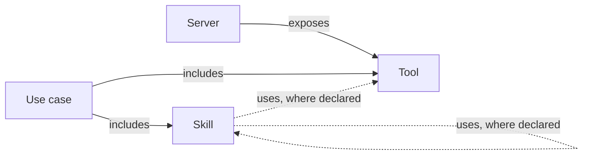
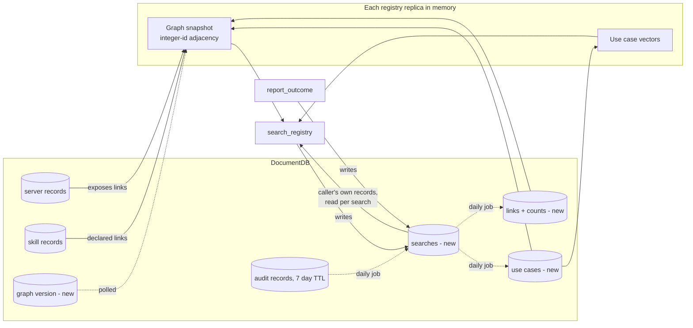

# Knowledge Graph Search (Enterprise Brain)

A plan for a registry that learns from its own use. Every search records the goal, the gateway sees which tools and skills the caller then used, and the next search for a similar goal gets those back as "worked before".

- Status: proposal. Nothing is built.
- Written against commit `3128817` of this fork of `agentic-community/mcp-gateway-registry`. The work stays in the fork for now.
- Code references were re-checked on 2026-11-11.

## Goal

The registry should find the right tools and skills when it holds thousands of them, many with near-identical names and descriptions. For a goal someone has pursued before, it should return the skills and tools that worked.

`search_registry` stays the one front door. Agents already call it, so nothing new has to be adopted before the brain can learn. The brain adds a section to its results and one new tool, `report_outcome`.

The brain stays on by default only if the eval shows all four of these:

1. On hidden tasks whose goal appeared in earlier use, search with the brain beats improved search. The headline metric is the share of tasks the agent completes with the right tools, and the paired 95% confidence interval of the difference must sit above zero.
2. With nothing learned, it returns exactly what improved search returns.
3. On goals it has never seen, and on every lookup category, it scores no more than 0.03 NDCG@10 below improved search.
4. It adds no more than 50 ms to p95 latency over improved search. Phase 0 measures search first and may revise this figure.

## The idea

Tool text collides. Fifty `get_item` tools described as "get an item by ID" produce the same vector, and no embedding model can separate text that is identical. The plan fixes this in two steps.

The first step is to embed more than the tool's own text. A tool's server has a name, a description and tags, and those differ between a ledger server and an inventory server. Phase 1 embeds each tool together with that context. This needs no learning and should separate tools that live in different domains.

The second step is to remember. A search query states a goal, and goal text collides far less than tool text: "refund a duplicate charge" and "close the month's books" are easy to tell apart. After a search, the gateway's own records show which tools the caller went on to call and which skills they loaded. The brain keeps that, and a later search for a similar goal returns it. Search engines learn from clicks the same way.

The two steps cover different cases:

| Case | Example | What tells the tools apart |
|---|---|---|
| Same tool, different domains | `get_item` on a ledger server and on an inventory server | Server context in the tool's vector (Phase 1) |
| Same tool, same domain, different backends | a refund tool on Stripe and on an in-house billing system | What this user, and then other users, used for the same goal |
| A goal that needs several tools | month-end close | The set of tools and skills used together for that goal before |

Nobody has to fill the graph in advance. People use plain search until it has something to add, and their use of search is what fills it.

Today's search does neither step:

- Each server is one search document with one embedding of all its tools (`registry/repositories/documentdb/search_repository.py:1077`).
- The default model, `all-MiniLM-L6-v2` (`registry/core/config.py:414`), truncates input at 256 word pieces, so most tool descriptions on a large server never reach the vector.
- Tools have no vectors of their own. The registry picks tools inside a server by substring match (`_score_tool_relevance`).
- Skill queries score NDCG@10 of 0.186 in `docs/benchmarks/search_quality_benchmark.md`, against 0.686 overall. That report measured one deployment's content, which is not in the repository.

## The graph



Four node types, three of them already stored:

| Node | Source |
|---|---|
| Server | existing server records |
| Tool | existing server tool lists |
| Skill | existing skill records |
| Use case | new collection, filled from use |

A use case is a goal that several people have pursued, with the skills and tools they used for it. It is the node that search matches against. Nobody writes or approves one: the brain creates it from use, and it holds a vector and links and no text.

| Link | Where it comes from |
|---|---|
| server exposes tool | server tool lists, rebuilt with each snapshot |
| use case includes skill or tool | what callers used after searching for that goal |
| skill uses tool | `allowed_tools`, where a skill sets it |
| skill uses skill | the `dependencies` field that #844 proposes |

The last two are rare today. The skill UI does not expose `allowed_tools`, skills seldom name the tools they need, and no standard links the two yet. The brain follows those links where they exist and does not depend on them. A goal links straight to whatever was used for it.

Every "includes" link has a row in a stored links collection, keyed by its two ends. The row counts how often search showed the item for that goal, how often the caller chose it, and how often the task then succeeded or failed.

The walk from a matched use case goes at most two hops, counted as tools reached from the goal. A run of declared skill-to-skill links counts as one hop, and the walk skips nodes it has already visited.

## How `search_registry` answers

The request gains one optional argument, `previous`, described under Reporting success. The response keeps every field it has today and gains four:

```json
{
  "search_id": "srch_9c41",
  "worked_before": [
    {
      "scope": "you",
      "skills": [{"name": "reconcile-ledger", "path": "/skills/reconcile-ledger"}],
      "tools": [{"route": "/ledger", "tool": "list_entries"}, {"route": "/ledger", "tool": "lock_period"}],
      "succeeded": 4,
      "failed": 0,
      "last_used": "2026-10-31"
    },
    {
      "scope": "shared",
      "use_case_id": "uc_41c7",
      "users": 12,
      "skills": [{"name": "generate-excel", "path": "/skills/generate-excel"}],
      "tools": [{"route": "/files", "tool": "write_xlsx"}],
      "succeeded": 31,
      "failed": 2
    }
  ],
  "connections": {"/ledger": "connected", "/files": "not_connected"},
  "report": {"tool": "report_outcome", "search_id": "srch_9c41"}
}
```

1. The registry runs improved search as it does today.
2. It embeds the query once and compares it with the caller's own past searches that led somewhere, and with shared use cases.
3. It drops anything the caller cannot see, using the same per-entity checks search uses, and drops any tool that no longer exists.
4. It returns the search results unchanged and puts the matches in `worked_before`, the caller's own first.

The brain only adds to search. Search results are never reordered or removed, so nothing becomes harder to find because the brain exists, and a tool or skill with no history is found exactly as it is today. Goal 2 turns that into a test.

When search returns many near-identical tools and `worked_before` is empty, the response groups them by server and tags so the agent can ask the user which one they mean.

## Learning

### What the gateway can observe

| Signal | Where it comes from | What it proves |
|---|---|---|
| The goal | the query the caller sent to `search_registry` | what they wanted |
| The agent loaded a skill body | the registry serves `get_skill_content` (`servers/mcpgw/server.py:882`) | which skill the agent used |
| A tool call was authorised | the audit record written during `/validate` (`auth_server/server.py:5379`, parsed by `registry/audit/mcp_logger.py`) | the caller tried to call that tool on that server |
| The caller searched again | a second search from the same caller within a few minutes, with a query vector close to the first | the first answer probably did not help |
| A report arrived | `report_outcome` from the agent, or a thumbs up or down from the user | what the agent or the user says happened |

Three limits follow from the code:

- The audit record cannot say whether a call worked. The auth server writes it before nginx forwards the request, with the status fixed to `success`. It proves the call was allowed.
- Audit records expire after 7 days by default (`audit_log_mongodb_ttl_days`). The learning job runs daily and copies what it needs into the search record, which lives longer.
- Nothing in a tool call names the search that led to it. The job matches by caller and time: a call belongs to the caller's most recent search, until their next search for a different goal or until `BRAIN_REPORT_WINDOW_MINUTES` passes. That match is approximate when one caller runs two tasks at once.

Learning needs to know who the caller is. If agents reach the gateway with one shared service token, every user's calls look like one caller's and the match mixes their tasks. The brain learns nothing from a caller whose token names no user. Deployments that want it need user tokens or on-behalf-of exchange (`docs/obo-token-exchange.md`).

### Reporting success

The gateway can see what the agent tried. Only the agent and the user know whether it worked, so the brain asks, and it makes answering cheap. A report can arrive three ways:

1. The agent calls `report_outcome` when the task ends.
2. The agent passes `previous` on its next `search_registry` call. An agent that searches again is already making a call, so the report costs no extra round trip.
3. The user gives a thumbs up or down on the feedback page in the registry.

The agent learns to report from two places. The `search_registry` description says to report when the task ends, and every response has a `report` field with the tool name and the `search_id`, so the reminder sits next to the results at the moment the agent reads them.

```
search_id: str
outcome: "succeeded" | "partial" | "failed"
used: list[{route: str, tool: str, error: bool}] | None
skills: list[str] | None
reason: "wrong_results" | "wrong_tool" | "no_backend_account" | "missing_access" | "tool_error" | "other" | None
source: "agent" | "user"
```

`previous` takes `search_id` and `outcome` only.

The report asks for facts before judgement. For each tool, the agent says whether the call came back as an error, which it can read from the MCP result. `outcome` is the agent's view of the whole task, and the tool description tells it to say `succeeded` only when the tools returned what the task needed and the user did not object. The report has no free-text field, so an agent cannot put words into the brain.

The brain does not take a report on trust:

- A report is tied to the caller who searched. The brain accepts one per source per search and none after the window closes.
- A tool in `used` counts only if the audit records show that caller calling it after that search. The brain drops the rest, so an agent cannot credit a tool it never called.
- A `succeeded` report followed within minutes by a search for the same goal counts as no report.
- A user's thumbs replaces the agent's report for that search.
- Reports carry different weight. A user's counts most, then an agent's failure, then an agent's success, because agents overstate success far more often than they invent failure. The eval sets the weights.
- `no_backend_account`, `missing_access` and `tool_error` change no counts, because the choice of tool was not at fault.

When no report arrives, the brain falls back to what it saw. A skill load or tool calls after a search, with no repeat search, count as a weak success. A repeat search counts as a weak failure.

### Personal memory

Each search writes a search record: the caller, the query's vector, what search showed, and later what the caller used and how it ended. At the next search the registry loads that caller's records, compares vectors in the process, and returns the closest ones that led somewhere under `"scope": "you"`.

A reported success shows up in the caller's own results after one occurrence. A success the brain only inferred from the time-window match shows up after `BRAIN_INFERRED_MIN_OBS` similar searches led to the same tool, because one inferred match may be a coincidence.

Personal memory needs no curation and no other users, and one user's history never reaches anyone else. It is the first thing built.

### Shared use cases

Admins cannot write or approve use cases for other people, so shared use cases approve themselves. That is safe because of what a use case contains. It holds a vector, links to tools and skills that already exist in the registry, and counts. It holds no text that a person or an agent wrote, so nothing one user's agent says can reach another user's agent through it.

A daily job, run under a lease so one replica owns it (the pattern in `registry/repositories/documentdb/agent_batch_job_repository.py`), turns personal memory into shared use cases. It retrieves before it creates, which is how it avoids duplicates:

1. For each new successful search record, it looks up the nearest existing use cases by vector.
2. If one is close and its tools overlap with the tools this caller used, the record joins that use case. The use case's vector moves toward the new one and its links gain the counts.
3. If the nearest one is close but its tools differ, the record starts a second use case. The same words can mean two goals, such as a refund on Stripe and a refund on an in-house system, and each caller later sees the one whose tools they can reach.
4. If nothing is close, the record starts a new use case.
5. A tool joins a use case by association. Pointwise mutual information corrects for how common a tool is, so a tool that everybody calls does not join every use case.
6. A use case becomes visible to others once at least `BRAIN_SHARED_MIN_USERS` distinct users have joined it. The floor rises with traffic, so a handful of users cannot shape what a large organisation sees. Until then it stays invisible.
7. A second pass merges use cases whose vectors and tools have drifted together, and hides any that nobody has used for `BRAIN_USE_CASE_IDLE_DAYS` or whose success rate has fallen below search's own.

Vector distance alone would merge goals that read alike and split one goal phrased two ways. Requiring the tools to overlap as well fixes both, and it needs no query text and no LLM. The eval sets both thresholds.

Two rules keep the loop honest. A link's score is its success rate among the times a caller chose it, with one success and one failure added up front, so a new link starts at 0.5 and one report cannot move it to 0 or 1. Counting only the times it was chosen stops the top result from winning because it is shown most. Search results also stay in every answer, so a new tool can still be found and chosen.

With no reviewer, four things stand between one user and everyone else's results. The user floor means one account cannot make a use case visible. The audit check means a report cannot credit a tool the caller never called. Access filtering means a viewer only ever sees tools they could already find through search. A use case with a poor success rate hides itself. The attack these close is real: a user who may register a remote server needs only the `register_service` permission (`registry/api/server_routes.py`), and could otherwise register a server, search a few times, call their own tool, report success, and place it in other users' results for a popular goal.

A user can dismiss a shared suggestion, which hides it for them and counts as a failure for its links.

## Backend accounts

A user can find a tool and still be unable to use it because they have no account on the backend, for example LeanIX. The gateway starts that sign-in at `POST /egress-auth/initiate` and finishes it at `GET /oauth2/egress/callback` (`registry/api/egress_auth_routes.py`). Today a failure only writes a log line. This work adds:

- a record per user and server of whether the sign-in started, completed or failed, holding no tokens or error bodies;
- `connections` in every search response, from `GET /egress-auth/connections`;
- an admin-written `access_instructions` field per server, returned for any server the user has not connected.

A failed sign-in marks that server unusable for that user and changes nothing else. None of this depends on the brain, so it can ship on its own schedule.

## Storage

Servers are the records behind `server_repository`, and skills are the records behind `skill_repository`. The brain reads tools from each server's tool list and never stores "server exposes tool", because the server record already implies it. It adds four collections:

| Collection | Holds | Kept for |
|---|---|---|
| searches | caller, query vector, items shown, items used, outcome | `BRAIN_SEARCH_RETENTION_DAYS` |
| use cases | vector, distinct-user count, visible or hidden | until idle for `BRAIN_USE_CASE_IDLE_DAYS` |
| links | the two ends and the shown, chosen, succeeded and failed counts | until an end is deleted |
| graph version | one number | forever |



### In memory

Personal memory needs nothing in memory. The registry reads one caller's search records per search, through an index on the caller, and compares a few hundred vectors.

The shared graph is a hand-built adjacency structure keyed by integer ids, with a matrix of use case vectors beside it. At 50,000 tools it takes tens of megabytes and the walk is a tight loop. NetworkX would hold the same links in about ten times the memory and walk them more slowly, so the brain does not use it. All graph code sits behind `graph.py`, so a graph library or engine can replace it later without changes to callers.

Reads take no lock. A rebuild builds a fresh snapshot and swaps one reference, so a request sees the whole old graph or the whole new one. Reports and the daily job never change the snapshot in place. They write to the collections, and the next rebuild folds the changes in.

### Replicas and churn

The Helm chart runs two registry replicas by default (`charts/registry/values.yaml`) and Terraform supports autoscaling, so a call to `mark_graph_dirty()` in one process tells the others nothing. The brain keeps a version number in DocumentDB. `mark_graph_dirty()` increments it, and each replica compares it with its own on a timer (`BRAIN_REBUILD_DEBOUNCE_SECONDS`). A replica rebuilds only when the number has moved, so a burst of registrations costs one rebuild per replica.

A rebuild reads names, paths and tool names from the server and skill records and skips schemas and descriptions. It assigns the integer ids afresh each time. The collections key everything by names and paths, so counts survive the rebuild.

There is no graph database and no cognee. DocumentDB supports `$graphLookup` only from 8.0.2, and Terraform and CDK deploy 5.0.0 (`terraform/aws-ecs/documentdb.tf:322`). The walk is small and bounded, so it runs in the registry process either way.

## Modularity and standards

Switching `BRAIN_ENABLED` off must leave the registry behaving exactly as it does today. Deleting the feature's folders and its registration lines must leave a registry that builds and passes its tests.

### Layout

| Path | Contents |
|---|---|
| `registry/brain/schemas.py` | Pydantic models for search records, use cases, links, and the request and response bodies |
| `registry/brain/constants.py` | Hop limit, score prior, windows and other constants |
| `registry/brain/memory.py` | Personal memory: rank one caller's past searches against a query vector. No I/O |
| `registry/brain/graph.py` | The shared graph: build the adjacency from plain records, swap snapshots, and walk. No I/O |
| `registry/brain/scoring.py` | Success-rate, association and ranking functions. No I/O |
| `registry/brain/access.py` | The single adapter to `registry/services/visibility.py` and `filter_tools_for_user` |
| `registry/brain/repository.py` | Storage interface and the DocumentDB implementation for the new collections |
| `registry/brain/learning.py` | The daily job: match audit records to searches, then join searches to use cases, merge and retire them |
| `registry/brain/service.py` | Builds `worked_before` for a search and handles `report_outcome` |
| `registry/brain/hooks.py` | `mark_graph_dirty()` and the search hook, both no-ops when the feature is off |
| `registry/api/brain_routes.py` | FastAPI routes, registered only when the feature is on |
| `servers/mcpgw/brain_tools.py` | `report_outcome`, registered only when the feature is on |
| `frontend/src/pages/` and `frontend/src/components/brain/` | Feedback page, where a user sees and deletes their own history |
| `scripts/brain_eval/` and `tests/fixtures/brain_eval/` | The eval harness, its frozen corpus and its ground truth |
| `tests/unit/brain/` and `tests/integration/brain/` | Tests |

The logic package follows `registry/egress_auth/`, whose routes also live in `registry/api/`. The brain keeps its storage inside its own package instead of extending `registry/repositories/interfaces.py` and `factory.py`. Those files are large and change often upstream, and every edit to them makes fork merges harder.

### Boundaries

- Code in `registry/brain/` may import from the rest of the registry. Outside it, only three places import from it: the route registration in `registry/main.py`, the search route's call to the search hook, and calls to `mark_graph_dirty()` where the registry already re-indexes a server or skill.
- `memory.py`, `graph.py` and `scoring.py` take plain data and return plain data, so unit tests need no database or embeddings model.
- All access decisions go through `access.py`, which calls the existing helpers. The brain never reimplements a visibility rule.
- A storage interface exists because a second implementation is plausible (an in-memory one for tests). The brain adds no other interfaces until a second implementation is needed.
- The brain adds no runtime dependency.

### Standards

The repository's `AGENTS.md` applies in full. The parts this feature touches most:

- Every request and response body is a Pydantic model with constraints in `Field(...)` and a `json_schema_extra` example.
- Private helpers start with `_` and sit at the top of each file. Functions stay under 50 lines, take one parameter per line and use PEP 604 type hints. Public functions have Google-style docstrings.
- Logging uses the standard configuration. The graph build logs its elapsed time and node and link counts. No log line contains query text or tokens.
- Errors use specific exception types. Access checks fail closed. If the brain fails, search returns its results without `worked_before`, because discovery is not an authorization decision.
- Coroutines never block. Embedding runs off the event loop, as search already does.
- New code reaches 80% test coverage. `uv run python scripts/test.py coverage -n 8`, `ruff`, `mypy` and `bandit` pass before each merge.
- Every new setting goes into `.env.example`, Docker Compose, Helm (including the chart's `reserved-env-names.txt`), Terraform with CDK parity, and `docs/unified-parameter-reference.md`.
- Every new or changed route goes into `api/openapi.json`, `api/registry_client.py` and `api/registry_management.py`, and the feature gets its own docs page in the same change as the code.

## Security

- The brain checks access on every item before it returns it, and never reports what it hid.
- The gateway checks every tool call against the caller's token, so a wrong suggestion fails safely. Filtering at discovery only decides what the brain shows. Under load the brain may therefore cache each user's visible set for `BRAIN_ACCESS_CACHE_TTL_SECONDS`. The cache holds only what the user may see, and a miss or an error computes the answer fresh. A tool revoked a moment ago can appear in `worked_before` until the cache expires, and calling it still fails at the gateway.
- One user's search history never appears in another user's results. Shared results come only from use cases that several users produced, and a use case holds no text.
- A search ID is 128 random bits and is tied on the server to the caller. `report_outcome` rejects another caller's ID.
- A use case reaches other users only after distinct users produce it, and a caller with no user identity produces none. Nobody approves one by hand (see Shared use cases).
- nginx rate-limits `report_outcome` at the edge with `limit_req`, never inside `/validate`.
- The registry stores no query text. It stores each query's vector for `BRAIN_SEARCH_RETENTION_DAYS`, because the vector is the goal that learning attaches to. A vector reveals less than the text and more than nothing, so only the brain's own repository reads the searches collection, and a user can delete their history from the feedback page.
- Each phase that touches routes, access or stored input gets a security review against `docs/SECURITY_GUIDELINES.md` before merge.

## Eval

### Measure the problem first

The collision problem is an argument so far. Phase 0 checks it against the running deployment before anyone builds a fix, using data the registry already has:

- how many tool names more than one server exposes, and how many of those share a description;
- from 7 days of audit records, how often a caller searches and then calls a tool, how often the same caller repeats a similar sequence, and the share of sessions that call tools on more than one server.

The first number says how much Phase 1 has to fix. The second says whether people repeat goals often enough for memory to pay, and whether the time-window match finds anything in real traffic.

### A frozen corpus

`tests/fixtures/search_dataset/` holds a README and no data. The benchmark's queries and ground truth were generated from one deployment's content and never committed, so nobody can reproduce its numbers from the repository. Phase 0 builds a synthetic corpus of fake servers, tools and skills with its own ground truth, commits it under `tests/fixtures/brain_eval/`, and measures today's search on it. Those numbers become the baseline. The 0.186 figure stays a description of one deployment.

Fake MCP servers answer with canned results and record every call. A program checks whether the recorded calls match the expected tools and arguments.

### Arms

| Arm | What it is |
|---|---|
| A | today's search |
| B | improved search: a vector per tool built from the tool and its server's name, description and tags, plus skill bodies in the skill index |
| C | arm B plus personal memory |
| D | arm C plus shared use cases |

Arm B has to be as strong as search can be made, or memory wins against a weak opponent.

The brain learns nothing from a hand-written answer key. The harness runs the tuning half of the tasks through the eval agent as several simulated users. Their searches, tool calls and reports fill the searches collection, the daily job runs, and only then does the harness score the hidden half.

### Tests

| Test | What it measures |
|---|---|
| Lookup | at least 30 queries per category, NDCG@10, for Goal 3 |
| Collision, different domains | the same tool on 1, 5, 10, 25 and 50 fake servers in different domains |
| Collision, same domain | the same tool on several backends in one domain, where only history can decide |
| Whole tasks | about 200 tasks written the way a user would say them, each with its correct tools. Half fill the brain, and half stay hidden for final scoring |
| Nothing learned | arms C and D with empty collections return the same results as arm B, for Goal 2 |
| Seen and unseen goals | hidden tasks split by whether the same goal appeared in the tuning half. Arm C should win on seen goals and must not lose on unseen ones |
| Another user's goal | hidden tasks given to a simulated user who never ran that goal, while others did. Only arm D can help here, and this is the test of shared use cases |
| Report rate | the tuning half replayed with agents reporting on all, half and none of their tasks, and with a share of reports wrong. The result says whether the brain works when agents stay silent, and how much reports add |
| Churn | tools and skills join and leave during the replay. The report plots quality against a tool's age |
| Duplicates | many simulated users phrase one goal in different ways, and two goals share wording but use different backends. The first must end as one use case and the second as two |
| Poisoning | one simulated user, then a pair, tries to push a tool into other users' results and must fail |

All tests run at 1,000 and 10,000 tools. Every comparison reports a paired 95% confidence interval.

### Models

Retrieval scoring uses no LLM. Whole-task runs use `qwen3:8b` on Ollama, pinned by digest, at temperature 0 with an 8,192-token context. The 4-bit build takes about 5.2 GB, so with that context it fits a GPU with 8 GB of memory, such as an RTX 3070. `qwen3:4b` is the fallback for smaller GPUs.

Each phase's final run repeats on Claude Opus 5.5 (`claude-opus-5-5`). A strong model picks well among many tools without help, which makes it the harder test for the brain, and if the two models disagree the Opus number decides. Claude Fable 5.2 is more capable and costs twice as much per token. One run on it before the Phase 4 decision is a reasonable extra check. The report-rate test also records how often each model reports unprompted, since a model that ignores the `report` field changes what the brain can learn.

`agents/agent.py` supports Amazon Bedrock and Anthropic, and it passes `temperature=0` to both (`agents/agent.py:1167`). Claude Opus 5.5 rejects that parameter, so the harness must drop it for Claude 5 models and set `effort` instead. Those runs cannot be made deterministic, so the Claude pass runs three times and reports the spread. The eval adds an Ollama provider through `langchain-ollama` as a development dependency only.

## Phases

| Phase | Work | Done when |
|---|---|---|
| 0 | The deployment measurement, the frozen corpus, the harness | One command reproduces the baseline from the repository, and the measurement report exists |
| 1 | Improved search: a vector per tool with server context, skill bodies in the skill index, tool annotations kept (#1818) | Measured on every test, and offered upstream |
| 2 | Personal memory: `search_id`, search records, the matching half of the daily job, `report_outcome` and `previous`, `worked_before` for the caller's own history, the feedback page | Goals 1 to 4 hold for arm C |
| 3 | Shared use cases, behind `BRAIN_SHARED_ENABLED`: the joining, merging and retiring half of the daily job, the graph snapshot with its version number | Arm D beats arm C on another user's goal, loses nothing elsewhere, and passes the duplicates and poisoning tests |
| 4 | `BRAIN_ENABLED` defaults to on | Goals 1 to 4 hold on the final Claude runs |

Phases 0 and 1 are the first release. They help every user of search, need none of the brain, and can go upstream. Each later phase is built only if the one before it passed.

Two results stop the work early. If improved search already leads the agent to the right tools on nine of ten hidden tasks, Phase 2 has no gap to close. If the deployment measurement shows that callers rarely repeat a goal, memory has nothing to remember, and Phase 2 waits until that changes. Backend accounts sit outside this sequence.

Settings, all off or conservative by default:

| Setting | Default |
|---|---|
| `BRAIN_ENABLED` | `false` |
| `BRAIN_SHARED_ENABLED` | `false` |
| `BRAIN_MIN_SCORE` | chosen on the tuning half in Phase 2 |
| `BRAIN_SEARCH_RETENTION_DAYS` | `90` |
| `BRAIN_REPORT_WINDOW_MINUTES` | `240` |
| `BRAIN_INFERRED_MIN_OBS` | `2` |
| `BRAIN_SHARED_MIN_USERS` | `3` |
| `BRAIN_USE_CASE_IDLE_DAYS` | `90` |
| `BRAIN_REBUILD_DEBOUNCE_SECONDS` | `30` |
| `BRAIN_ACCESS_CACHE_TTL_SECONDS` | `60` |

## Later, only if the phases above earn it

- Trust per client. The brain tracks how often each client application's success reports are later contradicted by a repeat search or a thumbs down, and gives less weight to clients that are often wrong.
- Asking the user for feedback through MCP elicitation, so success does not rest on the agent's word.
- Reading tool responses so the gateway knows whether a call worked.
- Carrying the `search_id` in the `_meta` field of tool calls where an MCP client supports it, for exact matching.
- Links between skills and tools learned from use ("loaded with", "called with"), once enough search records exist to tell a pattern from a coincidence.
- Best-path ranking once the graph is dense. Weighted shortest path on `-log(success rate)` picks the chain with the highest combined success rate, and the weights stay non-negative. A tested algorithm (NetworkX or rustworkx) goes in behind `graph.py`, and that query gets a higher hop limit.
- Display names for use cases, built from the names of their tools and skills, so people can browse them. Agents do not need a name.
- Working out step order from tool inputs and outputs.
- Per-group sharing and decay of old counts.
- Agents as nodes, sharing with peer registries, and OKF import and export.

## Risks

1. Phase 1 may solve the problem. If server context in tool vectors is enough, the brain is never built. That outcome costs two phases and still improves search.
2. People may not repeat goals. Memory pays only when the same user, or several users, pursue the same goal more than once. The deployment measurement checks this before Phase 2 starts.
3. Agents may not report, or may report success when they failed. The brain has to work on what the gateway sees alone, and the report-rate test checks that it does.
4. "Called" is not "worked". Without a report, the brain knows a call was allowed and nothing more.
5. The time-window match is approximate. A caller running two tasks at once produces wrong pairs, and the inferred-observation floor and the association score have to absorb them.
6. Callers may have no user identity. With a shared service token the brain learns nothing from those callers and shows them shared use cases only.
7. What ranks first gets chosen most. Scoring by success among the times chosen limits this, and plain search results stay in every answer so new tools are still found.
8. Nobody reviews a shared use case. A wrong one stays visible until its success rate falls or users dismiss it. The user floor, the audit check and automatic hiding are the only controls, and the poisoning test has to show they hold.
9. Use cases can split or merge wrongly. Two thresholds decide, and a bad setting gives either many near-duplicates or one use case that mixes goals. The duplicates test sets them.
10. Stored query vectors are a privacy cost. Retention is bounded, access is limited to the brain's repository, and users can delete their history.

## Decisions

- `search_registry` is the one front door. The plan no longer adds a second search tool.
- The one new tool is `report_outcome`, and `search_registry` accepts the same report through `previous`.
- The brain fills itself from use: the query is the goal, and the gateway's records show what was used.
- Personal memory is built before shared use cases.
- A use case approves itself: it becomes shared once enough distinct users produce it, and it holds no free text.
- The learning job looks up similar use cases before creating one, and joins a search to an existing use case when the vectors are close and the tools overlap.
- The brain never reorders or removes search results.
- The shared graph is a hand-built adjacency structure in each registry process. There is no graph database.
- The eval agent runs `qwen3:8b` on Ollama, and the confirmation pass runs Claude Opus 5.5.
