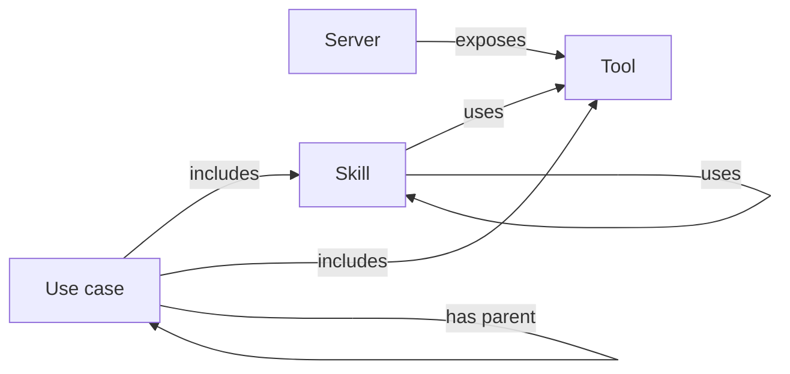
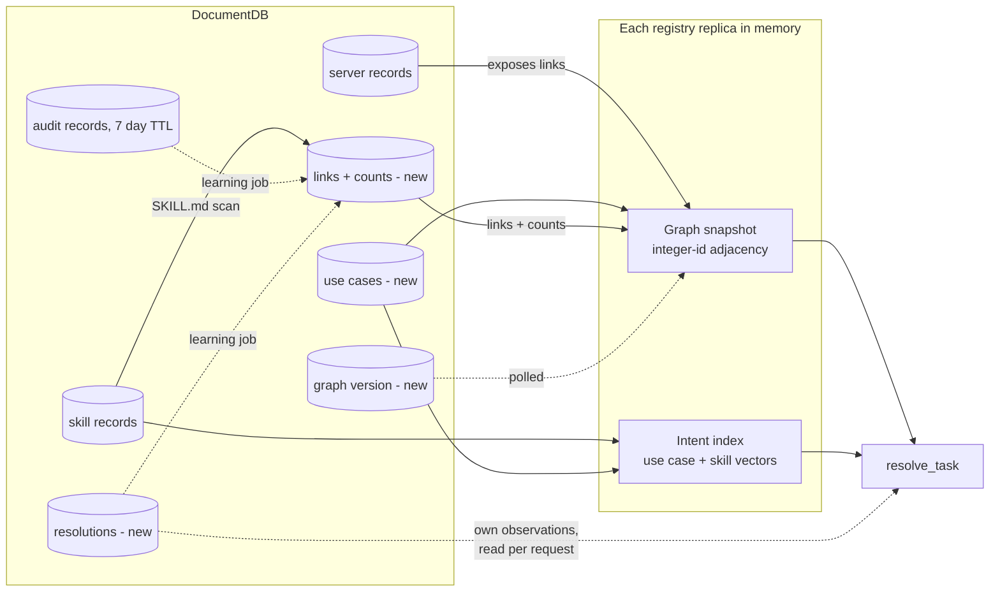

# Knowledge Graph Search (Enterprise Brain)

A plan for finding the right tools and skills in a large registry by searching goals as well as tool text, then following stored links from the matched goal to skills, tools and servers.

- Status: proposal. Nothing is built.
- Written against commit `3128817` of this fork of `agentic-community/mcp-gateway-registry`. The work stays in the fork for now.
- Code references were re-checked on 2026-11-11.

## Goal

The registry should find the right tools and skills when it holds thousands of them, many with near-identical names and descriptions. For a goal it has seen before, it should hand the agent the skills and tools that worked last time.

The new tool is `resolve_task`. It becomes the default entry point only if the eval shows all four of these:

1. It beats improved search on whole tasks at 10,000 tools. The headline metric is the share of hidden tasks the agent completes with the right tools, and the paired 95% confidence interval of the difference must sit above zero.
2. With an empty graph it returns exactly what improved search returns.
3. No lookup category scores more than 0.03 NDCG@10 below improved search.
4. It adds no more than 50 ms to p95 latency over improved search. Phase 0 measures search first and may revise this figure.

The plan also sets a stop rule before any graph code exists. Phase 2 is not built if Phase 0 and Phase 1 show both of the following: fewer than one in ten real sessions call tools on more than one server, and improved search already ranks the right tool first in nine of ten collision cases. In that case improved search is the product, and the graph has no gap left to close.

## The idea

Tool text collides. Fifty `get_item` tools described as "get an item by ID" produce the same vector, and no embedding model can separate text that is identical. The fix has two parts, taken in order.

The first part is to embed more than the tool's own text. A tool's server has a name, a description and tags, and those differ between a ledger server and an inventory server. Phase 1 embeds each tool together with that context. This costs little, needs no graph, and should separate tools that live in different domains.

The second part is to search goals. Goal text collides far less than tool text: "refund a duplicate charge" and "close the month's books" are easy to tell apart. The brain runs semantic search over goals (use cases and skills), then follows stored links from the match to tools and servers.

The two parts cover different cases:

| Case | Example | What tells the tools apart |
|---|---|---|
| Same tool, different domains | `get_item` on a ledger server and on an inventory server | Server context in the tool's vector (Phase 1) |
| Same tool, same domain, different backends | a refund tool on Stripe and on an in-house billing system | The caller's access and connected accounts, then learned success, then asking the user |
| A goal that needs several tools | month-end close | The graph: a use case or skill linked to its tools |

The graph has to prove itself on the third row and on learned preference. Phase 1 will probably settle the first row without it.

Today's search does neither part:

- Each server is one search document with one embedding of all its tools (`registry/repositories/documentdb/search_repository.py:1077`).
- The default model, `all-MiniLM-L6-v2` (`registry/core/config.py:414`), truncates input at 256 word pieces, so most tool descriptions on a large server never reach the vector.
- Tools have no vectors of their own. The registry picks tools inside a server by substring match (`_score_tool_relevance`).
- Skill queries score NDCG@10 of 0.186 in `docs/benchmarks/search_quality_benchmark.md`, against 0.686 overall. That report measured one deployment's content, which is not in the repository.

## The graph

"What tools serve this goal" has a path for an answer: goal to skills to tools, across servers. In a table that is a recursive join over four kinds of record. As a graph it is one bounded walk over typed links. A skill can use another skill, so the structure has cycles and cannot be a tree.



Four node types, three of them already stored:

| Node | Source |
|---|---|
| Server | existing server records |
| Tool | existing server tool lists |
| Skill | existing skill records |
| Use case | new collection |

Five link types:

| Link | Where it comes from |
|---|---|
| server exposes tool | server tool lists, rebuilt with each snapshot |
| skill uses tool | mentions in SKILL.md found at registration, `allowed_tools` where set, edits by users and admins, and learning (Phase 3) |
| skill uses skill | the `dependencies` field that #844 proposes, or mentions in SKILL.md found at registration |
| use case includes skill or tool | users and admins |
| use case has parent | users and admins, two or three levels deep |

Every link except "server exposes tool" has a row in a stored links collection, keyed by its two ends. The row records where the link came from (a person, the SKILL.md scan, or the learning job), a success count and a failure count. Each rebuild reattaches the counts.

### Links from SKILL.md

The skill UI does not expose `allowed_tools`, so most skills declare no tools. The registry already fetches SKILL.md when a skill registers, and a skill's instructions usually name what they call. The registry scans that text for two kinds of mention:

- a registered server's name or path together with one of that server's tool names;
- a tool name that only one server in the registry exposes.

Each match becomes a skill-to-tool link marked as found by the scan. The scan runs again when the skill or the server changes. The registry stores the links and keeps no copy of the text beyond what the skill index already holds. The same scan finds the names of other registered skills and produces skill-to-skill links.

A new skill therefore has links on the day it registers, with no curation and no usage history. Links from the scan and from `allowed_tools` are usable at once. A link the learning job creates has to be confirmed first (see Learning).

## Skills and use cases

A skill is a capability: how to do something. A use case is a goal: what someone wants done. "Generate Excel" is a capability that many goals reuse, so it stays a skill and does not become a use case.

1. Every skill is searchable as a goal in its own right. The brain indexes skills and use cases together, so "make a spreadsheet of these sales figures" matches the generate-excel skill directly. Nobody creates a use case per skill.
2. A use case exists only for a goal that spans more than one skill or tool. "Month-end close" includes the reconcile-ledger skill, the generate-excel skill and two ledger tools.
3. The links are many to many. Generate-excel can belong to month-end close, sales reporting and inventory reporting at once.
4. Categories are tags or parent use cases. "Spreadsheet generation" is a tag on the skill, and "Finance" is a parent use case. The walk never follows a parent link. Parents exist for browsing and for the editor.
5. The walk counts hops as tools reached from the goal. The limit is two hops, and a run of skill-to-skill links collapses into one hop: in `use case -> skill -> skill -> tool` the skill chain is the first hop and the tool is the second. The walk skips nodes it has already visited, so a loop (skill A uses B, B uses A) ends.
6. Credit goes to every link on a path that worked, so a skill that works across many use cases rises in all of them.

An example walk for "close the books for October":

```
matches use case  "Month-end close"
  includes skill  reconcile-ledger   -> uses tools  ledger.list_entries, ledger.post_adjustment
  includes skill  generate-excel     -> uses tools  files.write_xlsx
  includes tool   ledger.lock_period
```

## Orphans

Many skills and tools will have no link for a long time, and an enterprise adds new ones every day. The design has to find those as well as the well-connected ones.

- The brain finds an unlinked skill because the intent index holds a vector for every skill, whatever its links. Links add reach to tools and related skills on top of that direct match.
- Search finds an unlinked tool through its own vector (Phase 1). Tools stay out of the intent index because their text is what collides. `resolve_task` merges search results into every answer, so a confident graph match never hides an unlinked tool.
- An admin report lists the skills and tools that have no use case and no link, so a person can connect them. A tool also gains links as people use it, once learning is on.

The brain only adds to search. The search arm runs on every resolution and its results always appear in the answer, so nothing becomes harder to find because the graph exists. Goal 2 turns that sentence into a test.

## The tool: `resolve_task`

Draft tool description:

> Call this first whenever the user describes a task, or to look up a tool, skill or server by name. Pass `task` as one sentence saying what the user wants done, without names, IDs or customer data.

Phase 3 adds a second sentence asking the agent to call `report_resolution` when it finishes.

How it answers:

1. It embeds the task and ranks use cases and skills together by cosine similarity, held in memory. It runs improved search in parallel.
2. It drops anything the caller cannot see, using the same per-entity checks search uses.
3. It follows links from the best match for up to two hops, and drops a candidate if the caller cannot see one of its tools.
4. It ranks candidates by match score and by the success rate of the link that reached them.
5. It merges the graph candidates with the search results and returns both. If the graph adds nothing above the threshold, the result is plain search (`lookup` or `none`). If search returns many near-identical tools, it groups them by server and tags and asks which one the user means (`choice`).

Payload:

```json
{
  "resolution_id": "res_9c41",
  "kind": "plan",
  "match": {"name": "Month-end close", "type": "use_case", "score": 0.81},
  "alternatives": [{"name": "Quarterly close", "type": "use_case", "score": 0.52}],
  "skills": [
    {"name": "reconcile-ledger", "path": "/skills/reconcile-ledger", "summary": "Match ledger entries to bank lines"},
    {"name": "generate-excel", "path": "/skills/generate-excel", "summary": "Build an .xlsx from tabular data"}
  ],
  "tools": [
    {"route": "/ledger", "tool": "list_entries", "read_only": null, "input_schema": {}},
    {"route": "/ledger", "tool": "lock_period", "read_only": null, "input_schema": {}}
  ],
  "steps": null,
  "connections": {"/ledger": "connected", "/files": "not_connected"},
  "access_instructions": {"/files": "Request file-store access through the IT portal"}
}
```

- `kind` is `plan`, `choice`, `lookup` or `none`.
- The agent loads each skill body with `get_skill_content` when it needs it.
- `route` is the gateway path the agent calls with its own MCP client. Agents already have one, so the brain does not invoke tools itself.
- `read_only` stays `null` until MCP tool annotations reach the registry (#1818), and an agent must treat `null` as a tool that can change data.

`search_registry` keeps its name and its behaviour. Existing agents call it today, and the brain depends on the same search code. Phase 4 changes its description to send agents to `resolve_task` for tasks, and nothing is removed.

## Learning

Learning is Phase 3 and has its own flag, `BRAIN_LEARNING_ENABLED`. The static graph has to pass its gate first. Learning is the riskiest part of the plan because every signal it can use is weak, and this section says how weak.

### What the gateway can observe

| Signal | Where it comes from | What it proves |
|---|---|---|
| The agent loaded a skill body | the registry serves `get_skill_content` (`servers/mcpgw/server.py:882`) | which of the returned skills the agent used |
| A tool call was authorised | the audit record written during `/validate` (`auth_server/server.py:5379`, parsed by `registry/audit/mcp_logger.py`) | the caller tried to call that tool on that server |
| The caller asked again | a second `resolve_task` from the same caller within a few minutes, for a task whose vector is close to the first | the first answer probably did not help |
| A report arrived | `report_resolution` from the agent, or a thumbs up or down from the user | what the agent or the user says happened |

Three limits follow from the code:

- The audit record cannot say whether a call worked. The auth server writes it before nginx forwards the request, with the status fixed to `success`. It proves the call was allowed.
- Audit records expire after 7 days by default (`audit_log_mongodb_ttl_days`). The learning job has to run more often than that, and it cannot read history from before it was switched on beyond that window.
- Nothing ties a tool call to a resolution. An MCP client could send the `resolution_id` in the request's `_meta` field, but an agent cannot make its client do that, so the job falls back to matching by caller and time window. That match is approximate when one caller runs two tasks at once.

Learning also needs to know who the caller is. If agents reach the gateway with one shared service token, every user's calls look like one caller's, the time-window match mixes their tasks, and the distinct-user rules below never fire. Learning stays off for callers whose token names no user. Deployments that want it need user tokens or on-behalf-of exchange (`docs/obo-token-exchange.md`).

### `report_resolution`

```
resolution_id: str
outcome: "succeeded" | "partial" | "failed"
reason: "wrong_match" | "wrong_tools" | "no_backend_account" | "missing_access" | "tool_error" | "other" | null
source: "agent" | "user"
note: str | None              up to 500 characters
```

Rules:

- A success or failure adds to the counts on every link the resolution used. A report counts as one observation. A signal the gateway inferred (a skill load followed by authorised calls and no repeat request, or a repeat request) counts for less, and the eval sets the weight.
- `no_backend_account`, `missing_access` and `tool_error` change no counts, because the path was not at fault.
- A user's correction replaces the agent's report for that resolution.
- A link's score is its success rate with one success and one failure added up front, so a new link starts at 0.5 and a single report cannot move it to 0 or 1.
- A person's own observations change their own ranking at once.
- Shared ranking changes only when distinct users agree. `BRAIN_SHARED_MIN_USERS` is the floor for a quiet link, and the threshold rises with a link's traffic, so a handful of users cannot move what the whole organisation sees.
- A feedback page in the registry lists the user's recent resolutions with a thumbs up or down.

### Learned links

The learning job can create a skill-to-tool link that nobody declared and the SKILL.md scan did not find. It runs in the background under a lease, so one replica owns each run (the pattern in `registry/repositories/documentdb/agent_batch_job_repository.py`). It reads caller, server, tool name and timestamp from the audit records, and never reads call arguments or response bodies.

1. It matches each authorised tool call to a resolution by caller and time window.
2. It pairs the skills the agent loaded after that resolution with the tools the caller then called. If the agent loaded no skill, it pairs nothing.
3. It scores each pair by association. Pointwise mutual information corrects for how common a tool is, so a tool that everybody calls does not link to every skill.
4. It creates a link for that caller alone once the pair has appeared in `BRAIN_LEARNED_MIN_OBS` of their resolutions.
5. It promotes the link to shared ranking only after `BRAIN_SHARED_MIN_USERS` distinct users have the same link. Until then no other user sees it.
6. It writes links and counts to the links collection, and each replica picks them up at its next rebuild.

Association decides whether a link exists, and the success rate decides where it ranks.

Step 5 closes an attack. A user who may register a remote server needs only the `register_service` permission (`registry/api/server_routes.py`). Without the distinct-user rule, that user could register a server, run three resolutions, call their own tool after each, report success, and place the tool in other users' plans for a popular skill. Other users' agents would then read that tool's description and its output.

## Backend accounts

A user can find a tool and still be unable to use it because they have no account on the backend, for example LeanIX. The gateway starts that sign-in at `POST /egress-auth/initiate` and finishes it at `GET /oauth2/egress/callback` (`registry/api/egress_auth_routes.py`). Today a failure only writes a log line. This work adds:

- a record per user and server of whether the sign-in started, completed or failed, holding no tokens or error bodies;
- `connections` in every payload, from `GET /egress-auth/connections`;
- an admin-written `access_instructions` field per server, returned for any server the user has not connected.

A failed sign-in marks that server unusable for that user and changes nothing else. None of this depends on the graph, so it can ship on its own schedule and search results can show the same two fields.

## Storage

Nodes come from four places, and one is new. Servers are the records behind `server_repository`, and skills are the records behind `skill_repository`. The brain reads tools from each server's tool list. Use cases are the new collection.

The brain derives "server exposes tool" from the server tool lists and never stores it, because the server record already implies it. Every other link has a row in the new links collection. Resolutions are the third new collection. A resolution row holds the caller, the match, the links used, the outcome and the task's vector. The vector is there so the brain can tell a repeat request from a new task, and the row expires with `BRAIN_RESOLUTION_TTL_MINUTES`.



### In memory

The graph in memory is a hand-built adjacency structure keyed by integer ids. At 50,000 tools and up to a few million links it takes tens to low hundreds of megabytes and the walk is a tight loop. NetworkX would hold the same links in about ten times the memory and walk them more slowly, so the brain does not use it. All graph code sits behind `graph.py`, so a graph library or engine can replace it later without changes to callers.

Reads take no lock. A rebuild builds a fresh snapshot and swaps one reference, so a request sees the whole old graph or the whole new one. Reports and learned links never change the snapshot in place. They write to the collections, and the next rebuild folds them in. A user's own observations are a small set of rows read per request and applied on top of the shared ranking.

### Replicas and churn

The Helm chart runs two registry replicas by default (`charts/registry/values.yaml`) and Terraform supports autoscaling, so a call to `mark_graph_dirty()` in one process tells the others nothing. The brain keeps a version number in DocumentDB. `mark_graph_dirty()` increments it, and each replica compares it with its own on a timer (`BRAIN_REBUILD_DEBOUNCE_SECONDS`). A replica rebuilds only when the number has moved, so a burst of registrations costs one rebuild per replica.

A rebuild reads names, paths and tool names from the server and skill records and skips schemas and descriptions. It assigns the integer ids afresh each time. The collections key everything by names and paths, so counts survive the rebuild.

There is no graph database and no cognee. DocumentDB supports `$graphLookup` only from 8.0.2, and Terraform and CDK deploy 5.0.0 (`terraform/aws-ecs/documentdb.tf:322`). The walk is small and bounded, so it runs in the registry process either way.

## Modularity and standards

Switching `BRAIN_ENABLED` off must leave the registry behaving exactly as it does today. Deleting the feature's folders and its registration lines must leave a registry that builds and passes its tests.

### Layout

| Path | Contents |
|---|---|
| `registry/brain/schemas.py` | Pydantic models for use cases, links, resolutions, and the request and response bodies |
| `registry/brain/constants.py` | Hop limit, score prior, TTLs and other constants |
| `registry/brain/graph.py` | The in-memory graph: build the adjacency from plain records, swap snapshots, and walk. No I/O |
| `registry/brain/intent_index.py` | Embeddings matrix over use cases and skills, using the existing embeddings client |
| `registry/brain/skill_scan.py` | Finds server, tool and skill mentions in SKILL.md text. No I/O |
| `registry/brain/scoring.py` | Success-rate and ranking functions. No I/O |
| `registry/brain/access.py` | The single adapter to `registry/services/visibility.py` and `filter_tools_for_user` |
| `registry/brain/repository.py` | Storage interface and the DocumentDB implementation for the new collections |
| `registry/brain/learning.py` | The background job that reads audit records and writes learned links (Phase 3) |
| `registry/brain/service.py` | Orchestrates `resolve_task` and `report_resolution` |
| `registry/brain/hooks.py` | `mark_graph_dirty()`, a no-op when the feature is off |
| `registry/api/brain_routes.py` | FastAPI routes, registered only when the feature is on |
| `servers/mcpgw/brain_tools.py` | The mcpgw tools, registered only when the feature is on |
| `frontend/src/pages/` and `frontend/src/components/brain/` | Use case editor, orphan report and feedback page |
| `scripts/brain_eval/` and `tests/fixtures/brain_eval/` | The eval harness, its frozen corpus and its ground truth |
| `tests/unit/brain/` and `tests/integration/brain/` | Tests |

The logic package follows `registry/egress_auth/`, whose routes also live in `registry/api/`. The brain keeps its storage inside its own package instead of extending `registry/repositories/interfaces.py` and `factory.py`. Those files are large and change often upstream, and every edit to them makes fork merges harder.

### Boundaries

- Code in `registry/brain/` may import from the rest of the registry. Nothing outside it imports from it, except the route registration in `registry/main.py` and calls to `mark_graph_dirty()` where the registry already re-indexes a server or skill.
- `graph.py`, `skill_scan.py` and `scoring.py` take plain data and return plain data, so unit tests need no database or embeddings model.
- All access decisions go through `access.py`, which calls the existing helpers. The brain never reimplements a visibility rule.
- A storage interface exists because a second implementation is plausible (an in-memory one for tests). The brain adds no other interfaces until a second implementation is needed.
- The brain adds no runtime dependency.

### Standards

The repository's `AGENTS.md` applies in full. The parts this feature touches most:

- Every request and response body is a Pydantic model with constraints in `Field(...)` and a `json_schema_extra` example.
- Private helpers start with `_` and sit at the top of each file. Functions stay under 50 lines, take one parameter per line and use PEP 604 type hints. Public functions have Google-style docstrings.
- Logging uses the standard configuration. The graph build logs its elapsed time and node and link counts. No log line contains task text, feedback notes or tokens.
- Errors use specific exception types. Access checks fail closed. If the brain itself fails, the mcpgw tool falls back to plain search, because discovery is not an authorization decision.
- Coroutines never block. Embedding runs off the event loop, as search already does.
- New code reaches 80% test coverage. `uv run python scripts/test.py coverage -n 8`, `ruff`, `mypy` and `bandit` pass before each merge.
- Every new setting goes into `.env.example`, Docker Compose, Helm (including the chart's `reserved-env-names.txt`), Terraform with CDK parity, and `docs/unified-parameter-reference.md`.
- Every new route goes into `api/openapi.json`, `api/registry_client.py` and `api/registry_management.py`, and the feature gets its own docs page in the same change as the code.

## Security

- The brain checks access on each node before following links from it, and never reports what it hid.
- The gateway checks every tool call against the caller's token, so a wrong plan fails safely. Filtering at discovery only decides what the brain shows. Under load the brain may therefore cache each user's visible set for `BRAIN_ACCESS_CACHE_TTL_SECONDS`. The cache holds only what the user may see, and a miss or an error computes the answer fresh. A tool revoked a moment ago can appear in a plan until the cache expires, and calling it still fails at the gateway.
- The payload goes through the shared projection helpers and never includes credentials.
- A resolution ID is 128 random bits, tied on the server to the caller, and expires after an hour. `report_resolution` rejects another caller's ID and accepts one report per source per resolution.
- A learned link reaches other users only after distinct users produce it, and a caller with no user identity produces none (see Learned links).
- nginx rate-limits `resolve_task` and the feedback route at the edge with `limit_req`, never inside `/validate`.
- The registry scans use case text with its existing YARA scanner on every write, because other users' agents read it. Admins approve a use case before it is shared across the organisation.
- The registry stores no task text and logs no feedback notes. It keeps a task's vector for the life of the resolution row and then deletes it. A vector reveals less than the text and more than nothing, so the row is readable only by the brain's own repository.
- Each phase that touches routes, access or stored input gets a security review against `docs/SECURITY_GUIDELINES.md` before merge.

## Eval

### Measure the problem first

The collision problem is an argument so far. Phase 0 checks it against the running deployment before anyone builds a fix, using data the registry already has:

- how many tool names more than one server exposes, and how many of those share a description;
- from 7 days of audit records, the share of sessions that call tools on more than one server, and the tool pairs that occur together most often.

The first number says how much Phase 1 has to fix. The second says whether goals that need several tools are common enough to justify a graph, and it feeds the stop rule in Goal.

### A frozen corpus

`tests/fixtures/search_dataset/` holds a README and no data. The benchmark's queries and ground truth were generated from one deployment's content and never committed, so nobody can reproduce its numbers from the repository. Phase 0 builds a synthetic corpus of fake servers, tools and skills with its own ground truth, commits it under `tests/fixtures/brain_eval/`, and measures today's search on it. Those numbers become the baseline. The 0.186 figure stays a description of one deployment.

Fake MCP servers answer with canned results and record every call. A program checks whether the recorded calls match the expected tools and arguments.

### Arms

| Arm | What it is |
|---|---|
| A | today's search |
| B | improved search: a vector per tool built from the tool and its server's name, description and tags, plus skill bodies in the skill index |
| C | the brain with the static graph (Phase 2) |
| D | arm B plus memory: return the tools from the nearest past successful resolution, with no graph |
| E | the brain with learning (Phase 3) |

Arm B has to be as strong as search can be made, or the graph wins against a weak opponent. Arm D asks whether the graph structure earns anything over remembering what worked for a similar task. If D matches E, the simpler thing wins and the plan changes.

### Tests

| Test | What it measures |
|---|---|
| Lookup | at least 30 queries per category, NDCG@10, for Goal 3 |
| Collision, different domains | the same tool on 1, 5, 10, 25 and 50 fake servers in different domains |
| Collision, same domain | the same tool on several backends in one domain, where only access, connections or history can decide |
| Whole tasks | about 200 tasks written the way a user would say them, each with its correct tools. Half tune the system, and half stay hidden for final scoring |
| Empty graph | arm C with no use cases and no links returns the same results as arm B, for Goal 2 |
| Curation level | arm C with use cases written for none, a quarter and all of the goals, so the report shows what curation buys per hour of an admin's time |
| Learning over time | arm E replays resolutions from the tuning half while tools and skills join and leave. The report plots quality against a node's age and observation count |
| Seen and unseen goals | hidden tasks split by whether the learning replay contained the same goal. Arm E should win on seen goals and must not lose on unseen ones |
| Noisy reports | the learning replay with a share of reports missing and a share wrong, because production agents will skip and misreport |
| Poisoning | one simulated user tries to push a tool into shared ranking and must fail |

All tests run at 1,000 and 10,000 tools. Every comparison reports a paired 95% confidence interval.

### Integrity

A person who has not seen the task set writes the use cases, working from the server and skill catalogue alone. Otherwise the graph is an answer key. The hidden half of the tasks guards against tuning to phrasing, and the frontier model run guards against a result that only holds for a weak model.

### Models

Retrieval scoring uses no LLM. Whole-task runs use `qwen3:8b` on Ollama, pinned by digest, at temperature 0 with an 8,192-token context. The 4-bit build takes about 5.2 GB, so with that context it fits a GPU with 8 GB of memory, such as an RTX 3070. `qwen3:4b` is the fallback for smaller GPUs.

Each phase's final run repeats on Claude Opus 5.5 (`claude-opus-5-5`). A strong model picks well among many tools without help, which makes it the harder test for the brain, and if the two models disagree the Opus number decides. Claude Fable 5.2 is more capable and costs twice as much per token. One run on it before the Phase 4 decision is a reasonable extra check.

`agents/agent.py` supports Amazon Bedrock and Anthropic, and it passes `temperature=0` to both (`agents/agent.py:1167`). Claude Opus 5.5 rejects that parameter, so the harness must drop it for Claude 5 models and set `effort` instead. Those runs cannot be made deterministic, so the Claude pass runs three times and reports the spread. The eval adds an Ollama provider through `langchain-ollama` as a development dependency only.

## Phases

| Phase | Work | Done when |
|---|---|---|
| 0 | The deployment measurement, the frozen corpus, the harness | One command reproduces the baseline from the repository, and the measurement report exists |
| 1 | Improved search: a vector per tool with server context, skill bodies in the skill index, tool annotations kept (#1818) | Measured on every test, and offered upstream |
| 2 | The static graph: use cases and their editor, the SKILL.md scan, the snapshot with its version number, `resolve_task` with the merge, the orphan report | Goals 1 to 4 hold for arm C, unless the stop rule fired |
| 3 | Learning, behind `BRAIN_LEARNING_ENABLED`: the signals, the learning job, `report_resolution`, the feedback page | Arm E beats arm C on seen goals, does not lose on unseen ones, beats arm D, and passes the noisy-report and poisoning tests |
| 4 | `search_registry`'s description sends agents to `resolve_task` for tasks | Goals 1 to 4 hold on the final Claude runs |

Phases 0 and 1 are the first release. They help every user of search, need none of the graph, and can go upstream. Each later phase is built only if the one before it passed. Backend accounts sit outside this sequence.

Settings, all off or conservative by default:

| Setting | Default |
|---|---|
| `BRAIN_ENABLED` | `false` |
| `BRAIN_LEARNING_ENABLED` | `false` |
| `BRAIN_MIN_SCORE` | chosen on the tuning half in Phase 2 |
| `BRAIN_RESOLUTION_TTL_MINUTES` | `60` |
| `BRAIN_REBUILD_DEBOUNCE_SECONDS` | `30` |
| `BRAIN_ACCESS_CACHE_TTL_SECONDS` | `60` |
| `BRAIN_LEARNED_MIN_OBS` | `3` |
| `BRAIN_SHARED_MIN_USERS` | `3` |

## Later, only if the phases above earn it

- Suggested use cases. Clusters of similar task vectors from several users, or tool pairs that often occur together in the audit records, become drafts for an admin to approve. This fills the use case editor without asking anyone to start from a blank page.
- A tool-to-tool link ("used with") learned from the audit records. The log shows both ends of that link, so it needs no guess about which skill was in play.
- Best-path ranking once the graph is dense. Weighted shortest path on `-log(success rate)` picks the chain with the highest combined success rate, and the weights stay non-negative. A tested algorithm (NetworkX or rustworkx) goes in behind `graph.py`, and that query gets a higher hop limit.
- Reading tool responses so the gateway knows whether a call worked.
- Carrying the `resolution_id` on tool calls where an MCP client supports it, for exact matching.
- Working out step order from tool inputs and outputs.
- Per-group learning and decay of old counts.
- Agents as nodes, sharing with peer registries, and OKF import and export.
- Asking the user for feedback through MCP elicitation.

## Risks

1. Phase 1 may solve the problem. If server context in tool vectors separates most collisions and few sessions span servers, the stop rule fires and the graph is never built. That outcome costs two phases and still improves search.
2. The newest nodes are always cold. Every new tool and skill arrives with no history and no use case. The SKILL.md scan gives a new skill links on day one, and search covers the rest.
3. Nobody may write use cases. An empty editor is a dead feature. The curation-level test shows what a few hours of writing buys, and suggested use cases are first in the Later list for this reason.
4. Learning signals are weak. The gateway knows a call was allowed and does not know it worked, agents skip reports, and the time-window match is approximate. The noisy-report test decides whether learning survives that.
5. Callers may have no user identity. With a shared service token there is no personal ranking and no learning for those callers.
6. The eval can flatter the brain. The integrity rule, the hidden half, arm B's strength and arm D exist to stop that.
7. Use case text and tool descriptions can carry prompt injection into another user's agent. The YARA scan, admin approval and the distinct-user rule limit who can put text in front of whom.
8. Plans break when tools change. The brain checks each tool in a candidate against the current tool list before returning it, and drops candidates that point at tools that no longer exist.

## Decisions

- The tool name is `resolve_task`.
- The eval agent runs `qwen3:8b` on Ollama, and the confirmation pass runs Claude Opus 5.5.
- The walk counts hops as tools reached from the goal, with a limit of two.
- The graph is a hand-built adjacency structure in each registry process. There is no graph database.
- `resolve_task` always merges search results into its answer.
- Skill-to-tool links come first from scanning SKILL.md, and from learning only in Phase 3.
- `search_registry` stays.
