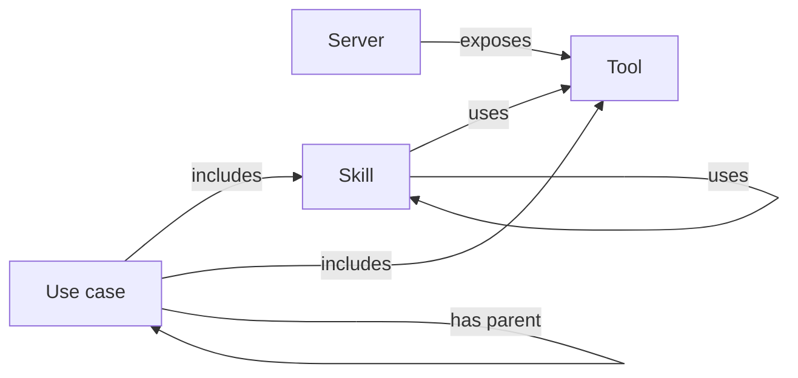
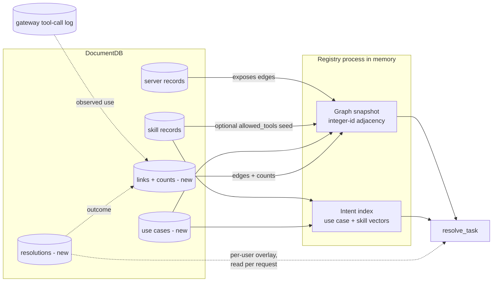

# Knowledge Graph Search (Enterprise Brain)

A plan for finding the right tools and skills in a registry that holds thousands of near-identical tools, by searching goals instead of tool text and following stored links from the matched goal to skills, tools and servers.

- Status: proposal. Nothing is built.
- Written against commit `3128817` of this fork of `agentic-community/mcp-gateway-registry`. The work stays in the fork for now.

## Goal

The registry should find the right tools and skills when it holds thousands of near-identical tools, such as fifty servers that each expose `get_item`, and hand the agent the path that solved the task before.

The new tool, `resolve_task`, replaces `search_registry` only if it passes two tests:

1. It beats improved search on whole tasks and on the collision test at 10,000 tools, with a 95% confidence interval above zero.
2. It scores no worse than `search_registry` on every lookup category in `docs/benchmarks/search_quality_benchmark.md`.

## The idea

Tool text collides. Fifty `get_item` tools described as "get an item by ID" look the same to any embedding model, and a better model cannot separate them, because what tells them apart sits outside the text. Goal text does not collide: "refund a duplicate charge" and "close the month's books" are easy to tell apart. So the brain runs semantic search over goals (use cases and skills), then follows stored links from the match to tools and servers.

Today's search cannot do this:

- Each server is one search document with one embedding of all its tools (`registry/repositories/documentdb/search_repository.py:1077`).
- The default model, `all-MiniLM-L6-v2`, truncates input at 256 word pieces, so most tool descriptions on a large server never reach the vector.
- Tools have no vectors of their own. The registry picks tools inside a server by substring match (`_score_tool_relevance`).
- Skill queries score NDCG@10 of 0.186 in the benchmark.

## The graph

The question "what tools serve this goal" is answered by a path, not a single record: goal to skills to tools, across servers. In a table that is a recursive join over four entity kinds; as a graph it is one bounded walk over typed edges. Two of the edge types connect a type to itself (a use case has a parent use case, a skill uses another skill), so the structure is a directed graph with cycles, not a tree. That is why it is modelled as a graph rather than a list or a hierarchy.



Four node types, three of them already stored:

| Node | Source |
|---|---|
| Server | existing server records |
| Tool | existing server tool lists |
| Skill | existing skill records |
| Use case | new collection |

Five link types:

| Link | Where it comes from |
|---|---|
| server exposes tool | server tool lists, rebuilt on each snapshot |
| skill uses tool | learned from observed tool calls (primary); `allowed_tools` as an optional seed where set |
| skill uses skill | a declaration, or detection at registration (see below) |
| use case includes skill or tool | users and admins |
| use case has parent | users and admins, two or three levels deep |

Every link except "server exposes tool" keeps its provenance (a person, or the learning loop), a success count and a failure count in a stored links collection, keyed by its two ends. Each rebuild reattaches the counts.

## Skills and use cases

A skill is a capability: how to do something. A use case is a goal: what someone wants done. "Generate Excel" is a capability that many goals reuse, so it stays a skill and does not become a use case.

1. **Every skill is searchable as a goal on its own.** The brain indexes skills and use cases together, so "make a spreadsheet of these sales figures" matches the generate-excel skill directly. Nobody creates a use case per skill.
2. **A use case exists only for a goal that spans more than one skill or tool.** "Month-end close" includes the reconcile-ledger skill, the generate-excel skill and two ledger tools.
3. **The links are many to many.** Generate-excel can belong to month-end close, sales reporting and inventory reporting at once, and month-end close can include several skills.
4. **A skill can use another skill.** The link comes from one of two places. A skill can declare it through the `dependencies` field that #844 proposes. Or the registry detects it at registration: it already fetches SKILL.md then, so it can look for the names of other registered skills in the text. The registry stores the detected links, not the text. Skills have no way to declare this today.
5. **Categories are tags or parent use cases.** "Spreadsheet generation" is a tag on the skill, and "Finance" is a parent use case. There is no separate category system.
6. **Hops count tools reached from the goal, not raw links.** The limit is two hops, and a run of skill-uses-skill links collapses into one hop, so the walk still reaches a tool under a composed skill: in `use case -> skill -> skill -> tool` the skill chain is the first hop and the tool is the second. The walk skips nodes it has already visited, so a loop (skill A uses B, B uses A) ends.
7. **Credit flows to every link on a path that worked.** A skill that works across many use cases rises everywhere.

An example walk for "close the books for October":

```
matches use case  "Month-end close"
  includes skill  reconcile-ledger   -> uses tools  ledger.list_entries, ledger.post_adjustment
  includes skill  generate-excel     -> uses tools  files.write_xlsx
  includes tool   ledger.lock_period
```

## The tool: `resolve_task`

Draft tool description:

> Call this first whenever the user describes a task, or to look up a tool, skill or server by name. Pass `task` as one sentence saying what the user wants done, without names, IDs or customer data. When you finish, call `report_resolution` once with the `resolution_id`.

How it answers:

1. It embeds the task and ranks use cases and skills together by cosine similarity, held in memory. It runs plain search in parallel.
2. It drops anything the caller cannot see, using the same per-entity checks search uses.
3. It follows links from the best match, up to two hops counted as tools-from-goal so a skill-to-skill chain is one hop, and drops a candidate if the caller cannot see one of its tools.
4. It ranks candidates by match score and success rate.
5. If nothing passes the threshold, it returns plain search results. If search returns many near-identical tools, it groups them by server and tags and asks which one the user means.

Payload:

```json
{
  "resolution_id": "res_9c41",
  "kind": "plan",
  "match": {"name": "Month-end close", "type": "use_case", "score": 0.81},
  "alternatives": [{"name": "Quarterly close", "type": "use_case", "score": 0.52}],
  "skills": [
    {"name": "reconcile-ledger", "path": "/skills/reconcile-ledger", "summary": "Match ledger entries to bank lines"},
    {"name": "generate-excel", "path": "/skills/generate-excel", "summary": "Build an .xlsx from tabular data"}
  ],
  "tools": [
    {"route": "/ledger", "tool": "list_entries", "read_only": null, "input_schema": {}},
    {"route": "/ledger", "tool": "lock_period", "read_only": null, "input_schema": {}}
  ],
  "steps": null,
  "connections": {"/ledger": "connected", "/files": "not_connected"},
  "access_instructions": {"/files": "Request file-store access through the IT portal"}
}
```

- `kind` is `plan`, `choice`, `lookup` or `none`.
- The agent loads each skill body with `get_skill_content` when it needs it.
- `route` is the gateway path the agent calls with its own MCP client. Agents already have one, so the brain does not invoke tools itself.
- `read_only` stays `null` until MCP tool annotations reach the registry (#1818), and an agent must treat `null` as a tool that can change data.

## Learning

`report_resolution` takes:

```
resolution_id: str
outcome: "succeeded" | "partial" | "failed"
reason: "wrong_match" | "wrong_tools" | "no_backend_account" | "missing_access" | "tool_error" | "other" | null
source: "agent" | "user"
note: str | None              up to 500 characters
```

Rules:

- A success or failure adds one to the counts on every link the resolution used, and can create a learned skill-to-tool link that did not exist (see Learned links).
- `no_backend_account`, `missing_access` and `tool_error` change no counts, because the path was not at fault.
- A user's correction replaces the agent's report for that resolution.
- A link's score is its success rate with one success and one failure added up front, so a new link starts at 0.5 and a single report cannot swing it to 0 or 1.
- A person's own reports change their ranking at once. Shared counts change only after three distinct users report the same way.
- A feedback page in the registry lists the user's recent resolutions with a thumbs up or down, for people who can sign in to the registry.

### Learned links

Most skill-to-tool edges are not declared, they are learned, because the skill UI does not expose `allowed_tools`. The gateway already logs every `tools/call` with its tool name and caller (`registry/audit/mcp_logger.py`, and the `tool_metrics` the metrics service stores), so the edge comes from behaviour rather than from the agent's self-report:

- A resolution returns a set of skills and tools. Within a short window the same caller's tool calls through the gateway are correlated to that resolution, and a succeeded outcome creates or strengthens a skill-to-tool edge for each skill that was in play and each tool that then ran.
- The tools come from the gateway's own log, not from what the agent says it did, so a wrong or missing self-report cannot forge an edge.
- A new learned edge starts below the traversal threshold and counts toward ranking only after `BRAIN_LEARNED_MIN_OBS` distinct resolutions confirm it, so one coincidental co-occurrence does not add a lasting edge.
- Correlating by caller and time window is approximate when one caller runs overlapping tasks. The observation threshold absorbs that noise, and reading tool responses for an exact per-call outcome stays a later improvement.

### Backend accounts

A user can find a tool and still be unable to use it because they have no account on the backend, for example LeanIX. The gateway starts that sign-in at `POST /egress-auth/initiate` and finishes it at `GET /oauth2/egress/callback` (`registry/api/egress_auth_routes.py`). Today a failure only writes a log line. v1 adds:

- a record per user and server of whether the sign-in started, completed or failed, holding no tokens or error bodies;
- `connections` in every payload, from `GET /egress-auth/connections`;
- an admin-written `access_instructions` field per server, returned for any server the user has not connected.

A failed sign-in marks that server unusable for that user and changes nothing else.

## Storage

Nodes come from four places, and only one is new. Servers are the records behind `server_repository`, skills the records behind `skill_repository`, and tools are read from each server's tool list rather than stored in their own right. Use cases are the one new collection.

Links divide into derived, declared and learned. "Server exposes tool" is derived from the server tool lists and never persisted, because the server record already implies it. "Skill uses tool" is mostly learned, not declared: the skill UI does not expose `allowed_tools`, so most skills carry none, and the edge is created from observed behaviour instead (see Learned links); where `allowed_tools` is set it seeds the edge as a weak prior. The authored links (skill uses skill, use case includes skill or tool, use case has parent) and every learned link live in a new links collection keyed by their two ends, each row carrying its provenance and a success and failure count. Resolutions are a third new collection; aggregated with the gateway call log, they create and strengthen the learned links.



The in-memory representation is a hand-built integer-id adjacency structure, not a graph library. At the enterprise ceiling of about 50,000 tools and a few million links, a compact integer-id adjacency holds in tens to low hundreds of megabytes and traverses in a tight loop. A general graph library such as NetworkX would hold the same edges in roughly an order of magnitude more memory and run its generic traversal more slowly on the one hot path, so it earns nothing here. The structure stays behind `graph.py`, which lets a later swap to a graph library or engine happen without touching callers if the algorithmic roadmap (centrality-based ranking, decay) ever justifies one.

Reads never take a lock, because an enterprise runs tens of thousands of users against one shared snapshot at once. A rebuild builds a fresh snapshot and swaps the module reference in one assignment, so a request sees the whole old graph or the whole new one, never a half-built mix. Live feedback never mutates that shared object: a report writes to the links and resolutions collections, and the shared counts fold into the snapshot at the next rebuild. Shared counts move slowly behind the three-user threshold, so folding them in on rebuild rather than in place stays accurate enough. A single user's own reports are a small, sparse overlay read from DocumentDB per request and applied on top of the shared ranking; the process never holds every user's overlay in memory.

Because an enterprise adds skills and tools constantly, the brain does not rebuild on each change. It marks the snapshot dirty and rebuilds on a short debounce, so a burst of registrations collapses into one swap. The integer-id map is rebuilt with each snapshot, and stable identity lives in the names and paths in the collections, so learned counts keyed by those endpoints survive the rebuild and the reassignment.

There is no graph database and no cognee. DocumentDB supports `$graphLookup` only from 8.0.2, and Terraform and CDK deploy 5.0.0 (`terraform/aws-ecs/documentdb.tf:322`), but the traversal is small and bounded, so it runs in the registry process either way.

## Modularity and standards

Switching `BRAIN_ENABLED` off must leave the registry behaving exactly as it does today. Deleting the feature's folders and its registration lines must leave a registry that builds and passes its tests.

### Layout

| Path | Contents |
|---|---|
| `registry/brain/schemas.py` | Pydantic models for use cases, links, resolutions, and the request and response bodies |
| `registry/brain/constants.py` | Hop limit, score prior, TTLs and other constants |
| `registry/brain/graph.py` | The in-memory graph: build the integer-id adjacency from plain records, swap snapshots, and traverse. No I/O |
| `registry/brain/intent_index.py` | Embeddings matrix over use cases and skills, using the existing embeddings client |
| `registry/brain/scoring.py` | Success-rate and ranking functions. No I/O |
| `registry/brain/access.py` | The single adapter to `registry/services/visibility.py` and `filter_tools_for_user` |
| `registry/brain/repository.py` | Storage interface and the DocumentDB implementation for the three collections |
| `registry/brain/service.py` | Orchestrates `resolve_task` and `report_resolution` |
| `registry/brain/hooks.py` | `mark_graph_dirty()`, a no-op when the feature is off |
| `registry/api/brain_routes.py` | FastAPI routes, registered only when the feature is on |
| `servers/mcpgw/brain_tools.py` | The two mcpgw tools, registered only when the feature is on |
| `frontend/src/pages/` and `frontend/src/components/brain/` | Use case editor and feedback page |
| `scripts/brain_eval/` and `tests/fixtures/brain_eval/` | The eval harness and its data |
| `tests/unit/brain/` and `tests/integration/brain/` | Tests |

The logic package follows `registry/egress_auth/`, whose routes also live in `registry/api/`. One difference is deliberate: the brain keeps its storage inside its own package instead of extending `registry/repositories/interfaces.py` and `factory.py`. Those files are large and change often upstream, and every edit to them makes fork merges harder.

### Boundaries

- Code in `registry/brain/` may import from the rest of the registry. Nothing outside it imports from it, except the route registration in `registry/main.py` and calls to `mark_graph_dirty()` where the registry already re-indexes a server or skill.
- `graph.py` and `scoring.py` take plain data and return plain data, so unit tests need no database or embeddings model.
- All access decisions go through `access.py`, which calls the existing helpers. The brain never reimplements a visibility rule.
- A storage interface exists because a second implementation is plausible (an in-memory one for tests). The brain adds no other interfaces until a second implementation is needed.
- No new runtime dependency. The graph uses integer-id adjacency dictionaries built by hand rather than a graph library, and the intent index uses the libraries already in `pyproject.toml`.

### Standards

The repository's `AGENTS.md` applies in full. The parts this feature touches most:

- Every request and response body is a Pydantic model with constraints in `Field(...)` and a `json_schema_extra` example.
- Private helpers start with `_` and sit at the top of each file. Functions stay under 50 lines, take one parameter per line and use PEP 604 type hints. Public functions have Google-style docstrings.
- Logging uses the standard configuration. The graph build logs its elapsed time and node and link counts. No log line contains task text, feedback notes or tokens.
- Errors use specific exception types. Access checks fail closed. If the brain itself fails, the mcpgw tool falls back to plain search, because discovery is not an authorization decision.
- Coroutines never block. Embedding runs off the event loop, as search already does.
- New code reaches 80% test coverage. `uv run python scripts/test.py coverage -n 8`, `ruff`, `mypy` and `bandit` pass before each merge.
- Every new setting goes into `.env.example`, Docker Compose, Helm (including the chart's `reserved-env-names.txt`), Terraform with CDK parity, and `docs/unified-parameter-reference.md`.
- Every new route goes into `api/openapi.json`, `api/registry_client.py` and `api/registry_management.py`, and the feature gets its own docs page in the same change as the code.

## Security

- The brain checks access on each node before following links from it, and never reports what it hid.
- Access filtering at discovery is a ranking concern, not the enforcement boundary, so under concurrent load the brain may cache each user's visible set briefly. The cache holds only positive visibility, carries a short TTL (`BRAIN_ACCESS_CACHE_TTL_SECONDS`, default 60), and fails closed on a miss or error by computing fresh. The worst case is that a just-revoked tool stays visible in a plan for up to the TTL, and calling it still fails at the gateway.
- The payload goes through the shared projection helpers and never includes credentials.
- A resolution ID is 128 random bits, tied on the server to the caller, and expires after an hour. `report_resolution` rejects another caller's ID and accepts one report per source per resolution.
- nginx rate-limits the feedback route at the edge with `limit_req`, never inside `/validate`.
- The registry scans use case text with its existing YARA scanner on every write, because other users' agents read it.
- The registry stores no task text and logs no feedback notes.
- The gateway still checks every tool call against the caller's token, so a wrong plan fails safely.
- Each phase that touches routes, access or stored input gets a security review against `docs/SECURITY_GUIDELINES.md` before merge.

## Eval (Phase 0)

The eval measures three setups: A (today's search), B (improved search) and C (the brain).

- **Fake MCP servers** answer with canned results and record every call. A program checks whether the recorded calls match the expected tools and arguments.
- **The collision test** puts the same tool on 1, 5, 10, 25 and 50 fake servers with different domains and measures how often the right one comes first.
- **The task set** holds about 200 tasks written the way a user would say them, each with its correct tools. Half tune the system, and half stay hidden for final scoring.
- **The lookup set** is the existing 100 queries in `tests/fixtures/search_dataset/`, used for the replacement gate.
- **Scale** runs at 1,000 and 10,000 tools.
- **Models:** retrieval scoring uses no LLM. Whole-task runs use `qwen3:8b` on Ollama, pinned by digest, at temperature 0 with an 8,192-token context. The 4-bit build takes about 5.2 GB, so with that context it fits a GPU with 8 GB of memory, such as an RTX 3070. `qwen3:4b` is the fallback for smaller GPUs. Each phase's final run repeats once on Claude Opus 5.5 (`claude-opus-5-5`). The most capable model is the hardest test for the brain, because a strong model picks well among many tools on its own. If the two runs disagree, the Opus number decides.
- **Agent:** `agents/agent.py` supports Amazon Bedrock and Anthropic. The eval adds an Ollama provider through `langchain-ollama`, as a development dependency only, so the registry's runtime dependencies stay unchanged.

Every comparison reports a 95% confidence interval.

## Phases

| Phase | Work | Done when |
|---|---|---|
| 0 | The eval above | One command reproduces today's numbers |
| 1 | Improved search: a vector per tool, skill bodies in the skill index, tool annotations kept (#1818) | Measured on every test; offered upstream |
| 2 | Use cases, skill-to-skill links, learned skill-to-tool links from the gateway call log, the in-memory graph, `resolve_task`, `report_resolution`, the feedback page, sign-in records | Beats improved search at 50 colliding servers and on hidden tasks; p95 latency no worse than search |
| 3 | Point `search_registry` at the brain for one release, then remove it | No lookup category scores worse than today |

Settings, all off or conservative by default:

| Setting | Default |
|---|---|
| `BRAIN_ENABLED` | `false` |
| `BRAIN_MIN_SCORE` | chosen on the tuning half in Phase 2 |
| `BRAIN_RESOLUTION_TTL_MINUTES` | `60` |
| `BRAIN_SHARED_MIN_USERS` | `3` |
| `BRAIN_ACCESS_CACHE_TTL_SECONDS` | `60` |
| `BRAIN_LEARNED_MIN_OBS` | `3` |

## Later, only if v1 earns it

- LLM-suggested use cases, using Ollama, grounded in each server's context.
- Learning whole use cases, not just skill-to-tool edges, from repeated tool sequences in the audit log.
- Working out step order from tool inputs and outputs.
- Reading tool responses so the gateway sees whether calls worked.
- Per-group learning and decay of old counts.
- Agents as nodes, sharing with peer registries, and OKF import and export.
- Asking the user for feedback directly through MCP elicitation.

## Risks

1. **The newest nodes are always cold.** An enterprise adds skills and tools constantly, so there is never a moment when the graph is fully populated: every new tool and skill arrives with no learned edges and no use case. The direct skill match and the search fallback are permanent first responders, not a launch-phase crutch, and a learned edge pays off only for entities that have been around long enough to accrue one.
2. **The outcome signal is thin.** Behavioural correlation supplies which tools ran, but whether the task actually succeeded still comes from a report or a user correction in v1, so learning is slow when neither arrives. The feedback page and user corrections matter most here, and reading tool responses for an automatic outcome is a later improvement.
3. **The registry may see an agent instead of a person.** When an agent uses its own credentials, or mcpgw runs with a service token, personal ranking applies to that service identity.
4. **The eval can flatter the brain.** The hidden half and the frontier confirmation run exist to stop that.
5. **Use case text can carry prompt injection.** The YARA scan catches known patterns, and admins review use cases before sharing them across the organisation.
6. **Plans break when tools change.** The brain checks each tool in a candidate against the current tool list before returning it, and drops candidates that point at tools that no longer exist.

## Decisions

- The tool name is `resolve_task`.
- The eval agent runs `qwen3:8b` on Ollama, and the confirmation pass runs Claude Opus 5.5.
